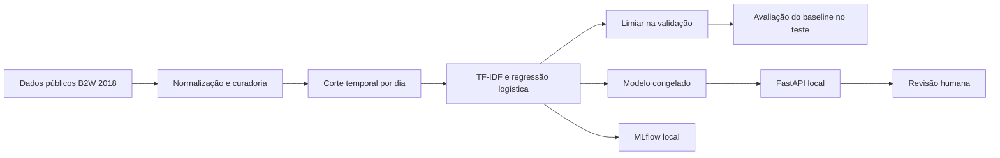

# Review Triage PT

**Classificação de avaliações em português para priorizar revisão humana, com avaliação temporal, rastreamento de experimentos e API local.**

Python · scikit-learn · TF-IDF · MLflow · FastAPI · Docker

## O problema

Como priorizar avaliações potencialmente negativas quando a equipe não consegue revisar todas? Este projeto estima se título e texto estão associados a notas **1 ou 2**, encaminhando esses casos para revisão humana. As estrelas são um **proxy**, sem anotação humana de sentimento ou ganho financeiro medido.

O baseline usa TF-IDF e regressão logística, corte temporal e limiar escolhido na validação. O projeto funciona em CPU local, sem AWS, APIs pagas ou dados da empresa.

## Resultado medido

Teste histórico de **8 a 31 de maio de 2018**, com 18.546 avaliações após curadoria:

| Medida | Baseline |
|---|---:|
| Macro-F1 | **0,9247** |
| Precisão para notas 1/2 | 0,8705 |
| Recall para notas 1/2 | 0,9180 |
| Average precision | 0,9417 |
| Encaminhadas para revisão | 30,15% |
| Macro-F1 da referência majoritária | 0,4166 |

O modelo identificou 4.868 dos 5.303 casos de notas 1/2. Deixou 435 fora da fila e encaminhou outros 724 casos de notas 3/4/5. São erros contra estrelas, sem comprovar resultados em produção. [Relatório completo](reports/INTERPRETACAO.md).

## Como funciona



- **Avaliação:** 90.870 registros de treino, 19.682 de validação e 18.546 de teste, sem textos normalizados idênticos entre partições.
- **Experimentos:** três execuções no MLflow, incluindo importação retrospectiva do baseline e duas variantes na validação, com métricas e artefatos.
- **Análise:** erros por nota, semana e comprimento; comparação título + corpo versus somente corpo na mesma validação.
- **Entrega:** API com validação de entrada, hash do modelo servido, limite de requisição e respostas sem eco do texto.
- **Verificação:** oito testes passaram, incluindo paridade da API com o modelo salvo. [Registro](reports/API_VALIDACAO.md).

## O que os experimentos mostram

Título + corpo obteve macro-F1 **0,9282**, versus **0,9058** apenas com corpo, nas mesmas 19.403 linhas de validação e com treino comum de 89.111 linhas. Os limiares foram escolhidos nessa validação: são números de seleção e podem ser otimistas. Nenhuma variante nova foi avaliada no teste.

Os erros do baseline se concentram nas notas 2 e 3. Isso orienta uma futura análise humana, sem provar por si só ambiguidade dos textos. [Análise detalhada](reports/ANALISE.md).

## Executar a demonstração

Pré-requisitos: Docker com contêineres Linux e PowerShell. Na raiz do projeto, baixe a base pública e gere o modelo localmente. Base e modelos não são distribuídos aqui.

```powershell
docker build -t review-triage-pt:local .
docker run --rm --mount "type=bind,source=$($PWD.Path),target=/project" -w /project review-triage-pt:local python scripts/download_data.py
docker run --rm --network none --mount "type=bind,source=$($PWD.Path),target=/project" -w /project review-triage-pt:local python src/train.py
docker run --rm --network none --mount "type=bind,source=$($PWD.Path),target=/project" -w /project review-triage-pt:local python -m unittest discover -s tests -v
docker compose up -d
docker compose exec -T api python src/demo.py
```

Abra [a interface da API](http://127.0.0.1:8000/docs). Para encerrar: `docker compose down`. A porta fica vinculada somente ao computador local. O download requer internet; treino e testes acima usam rede desativada.

[Reprodução completa e MLflow](docs/REPRODUCAO.md) · [Roteiro de demonstração](docs/DEMONSTRACAO.md) · [Ficha do modelo](docs/MODEL_CARD.md)

## Limitações

- Dados de 2018, sem validação na distribuição atual.
- A curadoria global exclui conflitos usando rótulos de todo o período antes da divisão. O resultado descreve uma amostra mais limpa e não replica fielmente uma ingestão produtiva.
- Deduplicação exata não elimina todas as paráfrases, templates ou sobreposição de produtos.
- Escore não calibrado. O limiar de 0,625 maximiza macro-F1 na validação; custo dos erros e capacidade da fila não foram validados.
- API demonstrativa local, sem autenticação, teste de carga ou implantação pública.

Possíveis evoluções: protocolo cronológico bruto, capacidade/calibração e embeddings, definidos antes de uma nova avaliação final independente.

## Dados e atribuição

[B2W-Reviews01](https://github.com/americanas-tech/b2w-reviews01), disponibilizado por **B2W Digital**, de **Livy Real, Marcio Oshiro e Alexandre Mafra**, sob [CC BY-NC-SA 4.0](https://creativecommons.org/licenses/by-nc-sa/4.0/). Respeite atribuição, uso não comercial e compartilhamento de derivados sob a mesma licença. Base e modelos derivados ficam locais, fora do Git. Usam-se somente título e texto como atributos; notas definem o alvo. Não são publicados textos, identificadores ou atributos demográficos de consumidores.

SHA-256 da base: `821fb0bf9f7230b0fba4e4f9fadd75a66d1a9ff0b1657810791d33007eb2ab38`.

## Estrutura

```text
src/        treinamento, análise, API e demonstração
tests/      testes de dados e contrato HTTP
scripts/    download da base com conferência de hash
reports/    métricas e diagnósticos agregados
docs/       reprodução, ficha do modelo e roteiro
data/       base local, ignorada pelo Git
artifacts/  modelos e MLflow local, ignorados pelo Git
```

Autor: [Carlos André](https://github.com/andresanto5) · [LinkedIn](https://www.linkedin.com/in/carlos-andr%C3%A9-ab702111a/)
